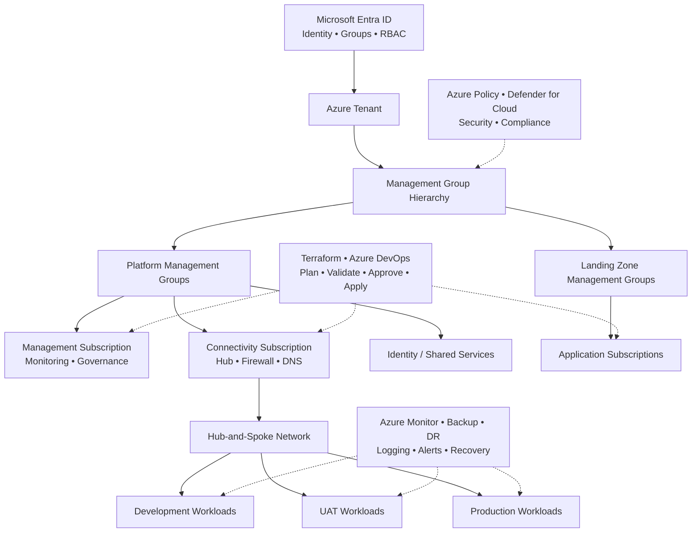
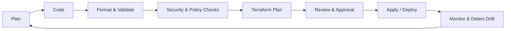

g

 

---

> **Animation note:** The animated header, typing text and footer are loaded from public SVG endpoints. GitHub renders these in the profile README when those services are reachable.

## 👋 About Me

I am a **DevSecOps and Azure Cloud Engineer** focused on engineering dependable cloud platforms and improving the way infrastructure and applications are delivered, secured and operated.

My interests span the full cloud engineering lifecycle: **platform architecture, identity and access management, infrastructure as code, CI/CD, security governance, cloud migration, observability, resilience and FinOps**.

I believe security should be built into every layer, automation should be repeatable, and production platforms should be designed for operability—not just deployment.

- ☁️ Design and engineer Azure landing zones and enterprise cloud foundations.
- 🔐 Embed identity, network, governance and workload security into platform design.
- ⚙️ Automate infrastructure and delivery workflows using Terraform and Azure DevOps.
- 🚀 Plan and execute cloud migration practices across development, UAT and production environments.
- 📈 Improve reliability, visibility and cost efficiency through monitoring, backup, disaster recovery and FinOps.
- 🤝 Collaborate across engineering teams, stakeholders and vendors to drive delivery and continuous improvement.

---

## 🧭 Engineering Domains

<table>
<tr>
<td width="50%" valign="top">

### ☁️ Azure Cloud & Landing Zones
- Azure tenant and management-group hierarchy
- Platform and workload subscriptions
- Azure landing zone architecture
- Cloud Adoption Framework (CAF)
- Hub-and-spoke platform design
- Multi-environment and multi-subscription governance
- Scalable, secure and highly available foundations

</td>
<td width="50%" valign="top">

### 🔐 DevSecOps & Security
- Identity and access management
- Microsoft Entra ID and RBAC
- Least-privilege access patterns
- Azure Policy and governance controls
- Microsoft Defender for Cloud
- Secure pipeline and infrastructure practices
- Secrets, configuration and state protection
- Security across identity, network and compute

</td>
</tr>
<tr>
<td width="50%" valign="top">

### 🏗️ Infrastructure as Code
- Terraform landing-zone automation
- Reusable and modular infrastructure code
- Remote state and state locking
- Encryption at rest and access control
- Formatting, validation and linting
- Security scanning and policy checks
- Cost estimation and manual approval gates
- Drift detection through pipelines

</td>
<td width="50%" valign="top">

### 🔄 CI/CD & Azure DevOps
- Azure Repos and Git workflows
- Branching strategies and branch policies
- Pull-request reviews and code owners
- Reusable YAML pipeline templates
- Build, test, validate and deploy stages
- Parallel jobs and environment approvals
- Deployment, apply and rollback workflows
- Release governance and traceability

</td>
</tr>
<tr>
<td width="50%" valign="top">

### 🌐 Enterprise Networking
- IP address management and CIDR planning
- On-premises network assessment
- Hub-and-spoke connectivity
- VNet peering and routing
- User-defined routes and firewall rules
- Private DNS and Private Endpoints
- VPN Gateway and ExpressRoute
- Centralised inspection and controlled egress

</td>
<td width="50%" valign="top">

### 🚚 Cloud Migration
- Discovery, assessment and readiness
- Migration strategy and dependency mapping
- Pre-migration and post-migration checklists
- Cutover planning and execution
- Hypercare and operational handover
- Dev, UAT and production coordination
- Workload validation and rollback planning
- Knowledge transfer and documentation

</td>
</tr>
<tr>
<td width="50%" valign="top">

### 🛡️ Reliability, Backup & DR
- High availability and resilience planning
- Azure Backup and recovery design
- Locally, zone and geo-redundant storage
- LRS, ZRS and GRS considerations
- Recovery Services Vault and backup policies
- RTO and RPO planning
- Primary and secondary region strategy
- Disaster recovery readiness and testing

</td>
<td width="50%" valign="top">

### 📊 Observability & FinOps
- Azure Monitor and platform monitoring
- Metrics, logs, alerts and diagnostics
- Operational dashboards and health signals
- Cost optimisation and resource hygiene
- Idle and unattached resource reviews
- Oversized compute assessment
- Log ingestion and retention optimisation
- Cost visibility and accountability

</td>
</tr>
<tr>
<td width="50%" valign="top">

### 🤝 Technical & Vendor Leadership
- Technical task and workstream assignment
- Scope, deliverables and acceptance criteria
- Sprint planning and dependency management
- RFP/RFI and technical evaluation
- Statements of Work and commercial alignment
- Risk, escalation and accountability models
- Weekly reviews and deliverable sign-off
- Documentation, RACI and knowledge transfer
- Team development and upskilling

</td>
<td width="50%" valign="top">

### 💡 Architecture & Continuous Improvement
- Architecture capability assessments
- Secure-by-design platform decisions
- Standardisation and reusable patterns
- Operational readiness and service transition
- Technical debt and risk reduction
- Automation opportunities and new initiatives
- Continuous improvement and engineering practices

</td>
</tr>
</table>

---

## 🧰 Technology & Tools

**Cloud & Identity**

**Infrastructure as Code & Automation**

**CI/CD & Engineering**

| Area | Technologies / Practices |
|---|---|
| Cloud | Microsoft Azure, subscriptions, management groups, landing zones |
| Identity & Governance | Microsoft Entra ID, RBAC, Azure Policy, Defender for Cloud |
| IaC | Terraform, reusable modules, remote state, validation, drift detection |
| CI/CD | Azure DevOps, Azure Repos, YAML pipelines, GitHub Actions |
| Networking | VNets, CIDR, peering, UDRs, Azure Firewall, Private DNS, Private Endpoints, VPN, ExpressRoute |
| Operations | Azure Monitor, logging, alerting, backup, disaster recovery |
| Engineering | Git, branching strategies, pull requests, code review, PowerShell |

---

## 🏛️ Enterprise Azure Platform — Reference Architecture

I am interested in designing enterprise platforms that provide consistent governance and secure connectivity while allowing application teams to deploy workloads independently.

**Architecture principles**
- Govern from the top; delegate access through clearly defined scopes and roles.
- Separate platform services from application workloads.
- Apply least privilege and secure defaults consistently.
- Centralise connectivity, inspection and shared services where appropriate.
- Automate repeatable deployments and make changes traceable.
- Design for availability, recoverability, observability and cost accountability.

---

## 🔒 Secure Infrastructure Delivery Lifecycle

My preferred delivery approach is to make infrastructure changes **reviewable, repeatable, policy-aware and auditable**. Production changes should have clear ownership, appropriate approvals, deployment visibility and a recovery path.

---

## 🚀 Cloud Migration — End-to-End View

For complex migration programmes, I focus on the complete lifecycle rather than the cutover alone:

1. **Discover** — inventory applications, infrastructure, dependencies and owners.
2. **Assess** — evaluate readiness, risks, compatibility, connectivity and target design.
3. **Plan** — define migration waves, responsibilities, prerequisites and rollback approach.
4. **Prepare** — establish landing zones, identity, network, security, monitoring and backup.
5. **Migrate** — execute controlled migration and cutover activities across environments.
6. **Validate** — verify application functionality, performance, security and integrations.
7. **Hypercare** — monitor closely, resolve issues and stabilise workloads.
8. **Transition** — complete documentation, operational handover and knowledge transfer.
9. **Optimise** — right-size resources, improve reliability and review cloud costs.

---

## 📌 What Good Platform Engineering Means to Me

| Principle | What it means in practice |
|---|---|
| Security by design | Identity, network, governance and workload controls from the beginning |
| Automation first | Repeatable infrastructure and delivery processes |
| Least privilege | Access scoped to the minimum permissions required |
| Reliability | Resilience, tested recovery and clear operational ownership |
| Governance | Standards, policy, accountability and traceable changes |
| Observability | Useful metrics, logs, alerts and actionable insights |
| Cost awareness | Right-sized resources and continuous cost optimisation |
| Collaboration | Clear communication, documentation and shared ownership |

---

## 📚 Continuous Learning

Cloud platforms and security practices evolve constantly. I value hands-on learning, architecture reviews, automation experiments and sharing practical engineering knowledge.

My ongoing areas of interest include:
- Azure landing-zone and Cloud Adoption Framework patterns
- Advanced Terraform module design and policy-as-code
- DevSecOps pipeline security and software supply-chain practices
- Enterprise networking, private connectivity and zero-trust principles
- Cloud resilience, disaster recovery and operational excellence
- FinOps and measurable cloud optimisation

---

## 🤝 Let's Connect

I enjoy connecting with cloud engineers, DevSecOps professionals, platform architects and technology teams who care about building secure and reliable systems.

**If you are working on Azure, Terraform, DevSecOps, cloud migration or platform engineering, let's exchange ideas and learn from each other.**

*Secure by design. Automated by default. Reliable in production.*

